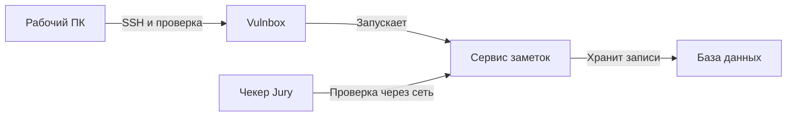

# 01. Как устроен Attack/Defense CTF

[К оглавлению](./README.md)

Представь сайт «Заметки». Пользователь входит, пишет заметку и может прочитать её позже. Для игры каждой команде выдают свою копию этого сайта. Судейский **чекер** создаёт в нём запись с секретной строкой — **флагом** — и спустя некоторое время пробует прочитать её обратно.

У команды одновременно две игровые цели. Первая — держать свои сервисы рабочими для штатных действий и защищать их данные. Вторая — получать очки за флаги соперников по правилам турнира. Эти цели идут параллельно: победа в одном раунде по доступности ещё не говорит, что данные всё время были защищены.

Из этой заметки ты узнаешь, кто с кем общается, как устроен один раунд и почему фраза «сайт же открывается» может быть одновременно верной, а статус чекера — красным.

## 1. Кто и что участвует в игре

| Кто или что | Простое объяснение | Пример |
|---|---|---|
| **Команда** | Участники, которые играют вместе и ведут свою инфраструктуру | Ты проверяешь сервисы, напарник следит за SSH и временем правок |
| **Рабочий ПК** | Устройство, с которого ты подключаешься к игре | Ноутбук с браузером и терминалом |
| **Vulnbox** | Сервер или виртуальная машина, выданная вашей команде | На нём запущены заметки, чат и база |
| **Сервис** | Отдельное приложение со своим поведением, настройками и данными | Сайт заметок на своём порту |
| **Хранилище** | Место, где остаются записи после завершения запроса | База данных, файл или Docker-том |
| **Чекер** | Судейская программа, проверяющая сервис через предусмотренный интерфейс | Создаёт заметку, открывает её, проверяет сохранённый текст |
| **Jury** | Судейская инфраструктура, с которой связаны проверки и результаты | В инструкциях InnoCTF у Jury указан отдельный сетевой адрес |
| **ForcAD** | Платформа, которая ведёт раунды, запускает проверки и ведёт учёт игры | Её использовали на InnoCTF |
| **Скорборд** | Табло, где читают позиции, очки и статусы сервисов | Строка вашей команды и статус «Заметок» в последнем раунде |

Обычно у команды один выданный vulnbox и несколько сервисов. Конкретная схема зависит от площадки. Все сервисы на одной машине могут иметь разные состояния: сайт заметок исправен, чат не запускается, а у третьего приложения пропали старые записи. Поэтому в командном чате полезно называть **имя сервиса**, а не только имя сервера.

Вот схема для одного сервиса:

Смысл схемы в трёх отдельных путях. Ты можешь войти по SSH, даже если приложение остановилось. Приложение может показывать главную страницу, даже если потеряло связь с базой. И наконец, приложение может работать внутри vulnbox, а судейская сеть не сможет до него добраться.

## 2. Чем A/D отличается от обычного CTF с заданиями

| Вопрос | Jeopardy CTF | Attack/Defense |
|---|---|---|
| Что выдают участнику? | Задачи с описанием, файлами или доступом к сервису | Свою машину с сервисами, которые команде предстоит поддерживать |
| Что происходит со временем? | Ты сам выбираешь, какую задачу решать следующей | Идут раунды и автоматические проверки, пока команда работает над другими задачами |
| Откуда берутся очки? | Из решений отдельных задач по формуле турнира | Из игровых флагов и других показателей по формуле турнира. Работа своих сервисов тоже может влиять на результат |
| Что значит «починили»? | Для решения задачи обычно достаточно получить и сдать флаг | Изменение должно сохранять штатное поведение сервиса и его данные |
| Что делает команда при сбое? | Может отложить незавершённое задание | Проверяет, что сломалось, устраняет причину и подтверждает восстановление |

Отсюда полезная привычка: **до правки зафиксируй, как выглядит штатная работа**. Тогда после правки у тебя есть с чем сравнить. При первом A/D можно взять один сервис и научиться уверенно отвечать на три вопроса: доступен ли он с рабочего ПК, работает ли обычное действие и сохранились ли прежние данные.

## 3. Что команда получает на старте

Состав выдачи меняется от турнира к турниру. Перед тем как кто-то тронет настройки, заполните эту мини-карточку:

| Что записать | Почему это важно |
|---|---|
| Номер вашей команды и IP её vulnbox | Адрес в примере может принадлежать другой команде или тестовой машине |
| Как попасть на сервер и есть ли запасная консоль | Если SSH перестанет принимать новые подключения, через консоль можно вернуть настройки |
| Как подключиться к игровой сети | Понимаешь, через какую сеть или VPN открываются приватные адреса |
| Перечень игровых сервисов и внешние порты | Сможешь отличить официальную задачу от служебного процесса |
| Где смотреть результаты | Видишь статус конкретного сервиса и раунд, а не только место команды |
| Когда откроют сеть, сколько идёт раунд и когда закончится матч | Можешь разделить подготовку на короткие отрезки и вовремя сверить результаты |
| Куда писать при сбое | Подготовишь точный вопрос про конкретный хост, сервис и время |

Условный пример записи в командной заметке:

> Команда 17. Наш сервер — 10.2.17.2. Игровые сервисы — заметки и чат. Доступом занимается Лена, заметками — Тимофей. Результаты смотрим в Jury. Если пропадёт SSH, открываем консоль по инструкции площадки.

Примерные имя, IP и состав сервисов здесь придуманы. Пароли, приватные ключи и игровые токены держите в предусмотренном для секретов месте.

## 4. Один раунд на примере сервиса заметок

**Раунд**, или **тик**, — отрезок игрового времени. Чекеры выполняют предусмотренные платформой действия в рамках раундов. Они могут выполняться для разных сервисов и команд с разным временем начала и завершения. Пример ниже нужен, чтобы понять причинно-следственную связь.

Допустим, для «Заметок» штатный сценарий такой: открыть сайт, войти, создать запись и прочитать её. У чекера три вида действий.

| Действие | Что проверяет | Как выглядит в нашем примере |
|---|---|---|
| **CHECK** | Обычную работу сервиса | Тестовый пользователь входит, создаёт заметку и читает её |
| **PUT** | Что сервис принимает и сохраняет новый флаг | Чекер сохраняет секретную строку в заметке |
| **GET** | Что ранее сохранённый флаг можно получить обратно | Чекер возвращается к старой заметке и сверяет её текст |

`CHECK`, `PUT` и `GET` здесь называются действиями чекера. У сервиса при этом могут быть свои HTTP-методы и маршруты. Точный сценарий зависит от задачи. В документации ForcAD описаны условия вызова этих действий и варианты настройки количества проверок. [Документация чекера ForcAD](https://github.com/pomo-mondreganto/ForcAD/wiki/Writing-a-checker)

### Пример из четырёх раундов

| Раунд | Что сделала команда | Что увидел чекер |
|---|---|---|
| **12** | Сервис работает со своей постоянной базой | Вход и сохранение работают. Чекер положил флаг в заметку №41 |
| **13** | Команда сменила настройку, и приложение запустилось с пустой базой | Главная страница открывается. Новую заметку создать можно, а запись №41 пропала. Если прочитать нужно именно её, возможен `CORRUPT` |
| **14** | Команда вернула прежнее подключение и проверила старую запись | Заметка №41 снова доступна. Записи, сделанные во временную базу, нужно учитывать отдельно |
| **15** | Команда проверила чтение и запись на постоянной базе | Новый раунд может показать `OK`, если все предусмотренные для него проверки прошли |

Эта история объясняет, почему **новая запись и старая запись проверяют разные вещи**. Новая показывает, что запись вообще работает. Старая показывает, что данные пережили изменения и лежат в правильном хранилище. Поэтому скрин главной страницы или один ответ `200 OK` покрывает только часть проверки.

## 5. Как понимать флаги

**Флаг** — секретное игровое значение, которое платформа связывает с конкретной задачей, командой и раундом. Для «Заметок» он лежит в тексте записи. В другой задаче его могут положить в файл или объект приложения.

У одной записи в учебном примере есть несколько разных полей:

| Что | Условный пример | Для чего это |
|---|---|---|
| **Внутренний ID записи** | `41` | Приложение знает, о какой заметке речь |
| **Текст записи** | `DEMO-FLAG-ROUND-12` | Учебное обозначение секрета внутри записи |
| **Идентификатор для чекера** | Данные, необходимые для повторной проверки | Помогает чекеру узнать, к какой ранее сохранённой записи вернуться |
| **Публичные игровые данные** | Например, имя тестового пользователя, если это предусмотрено задачей | Их может публиковать платформа. В ForcAD такое поле часто связано с `attack_data` |

Лексика отличается между турнирами. В ForcAD публичные игровые данные и внутренний `flag_id` чекера могут быть разными полями. Точные значения и интерфейс берутся из регламента. [Конфигурация ForcAD](https://github.com/pomo-mondreganto/ForcAD#configuration-and-usage)

**Flag lifetime** — сколько раундов флаг остаётся действительным по правилам платформы. На InnoCTF в инструктаже указано 5 раундов по 2 минуты, то есть примерно **10 минут игрового времени**. Срок действительности флага и время хранения заметки в БД — разные вещи. Платформа считает срок по раундам, а база может сохранить строку и после него. [Конфигурация ForcAD](https://github.com/pomo-mondreganto/ForcAD#configuration-and-usage)

## 6. Как читать очки и табло

На каждом новом турнире выясни, **из чего собирается счёт**. Обычно в обсуждении A/D встречаются три понятия:

- **Атака.** Очки за флаги соперников, принятые по правилам игры.
- **Защита.** Компонент, связанный с тем, смогли ли соперники получить очки на ваших сервисах. Отдельная колонка и расчёт зависят от платформы.
- **SLA или доступность.** Как стабильно сервис проходит судейские проверки. В ряде формул это отдельное число или множитель. Считать его как простую долю раундов можно только тогда, когда это предусмотрено регламентом.

Счёт и статус отвечают на разные вопросы. В данный момент у сервиса может быть `OK`, хотя в предыдущих раундах он падал или принёс очки соперникам. Место команды может меняться, даже если твои сервисы не менялись, потому что играют и остальные команды.

В базовом ForcAD формула рейтинга настраивается. `hardness` относится к тому, насколько сильно меняется рейтинг при принятой атаке, а базовый `score` относится к стартовой оценке задачи. Число `2500` из инструктажа само по себе не даёт цену одного флага. [Рейтинг ForcAD](https://github.com/pomo-mondreganto/ForcAD/wiki/Rating-system)

### Как прочитать одну строку

Допустим, на табло показывается:

> Команда 17 · Заметки · раунд 13 · `CORRUPT`.

1. Найди **конкретный сервис**. Возможно, остальные работают.
2. Запиши **раунд и время**. Самый свежий статус относится к моменту проверки, а не к каждой секунде после неё.
3. Посмотри, что штатно работало до этого. Если в раунде 12 всё было зелёным и между 12 и 13 меняли БД, это проверяемая гипотеза.
4. После восстановления повтори свой штатный тест и сравни его со следующим результатом Jury.
5. Если табло заморожено, уточни по регламенту, какие результаты продолжают считаться и когда их покажут.

## 7. Что означают статусы чекера

Ниже — значения из документации ForcAD. У турнира может быть своё отображение, цвет и текст ошибки. Если Jury показывает пояснение, сохрани его вместе со статусом.

| Статус | Как понимать | Первый вопрос к себе |
|---|---|---|
| **`OK`** | Текущая проверка завершилась успешно | С каким состоянием сервиса получили этот результат? Полезно записать его перед правкой |
| **`DOWN`** | Чекер не смог нормально установить соединение | Сервис запущен? Слушает нужный порт? Он доступен из нужной сети? |
| **`MUMBLE`** | Сервис не выполняет ожидаемое действие | Где ломается штатный сценарий — вход, создание, чтение или обращение к зависимости? |
| **`CORRUPT`** | На этапе чтения не удалось вернуть ранее сохранённый флаг | Доступна ли прежняя запись? Подключены ли правильная база и том? |
| **`CHECKER_ERROR`** | При выполнении проверки произошла неожиданная ошибка | Есть ли подробности в Jury? Воспроизводится ли обычное действие? Что из наблюдений передать жюри? |

[Статусы ForcAD](https://github.com/pomo-mondreganto/ForcAD/wiki/Writing-a-checker)

Два быстрых примера:

- **С ПК вообще не открывается порт.** Начни с процесса, нужного порта и доступа по сети. Успешный SSH на тот же хост подтверждает только доступность SSH.
- **С ПК сайт открывается, но старая учебная запись исчезла.** Проверь, куда подключено приложение и какие данные там есть. Перезапуск сам по себе не вернёт записи из другого хранилища.

**Для командного чата** достаточно сообщения «Заметки, раунд 13, `CORRUPT`. Вход и создание работают, старая тестовая запись не найдена. Последняя правка — настройки БД». По нему напарник уже знает, какой слой проверять.

## 8. Что делает команда до и во время матча

### До открытия сети

1. **Закрепите доступ.** У ответственного есть работающий вход и известный запасной путь через консоль.
2. **Составьте инвентарь.** Для каждого игрового сервиса запишите внешний порт, способ запуска и путь к данным.
3. **Зафиксируйте нормальное поведение.** Например, с рабочего ПК можно войти, создать свою тестовую заметку и прочитать её.
4. **Сделайте копии перед правками.** В карточке сервиса запишите, куда скачали копию, какие данные в ней находятся и как подтвердить её пригодность.
5. **Назначьте ответственных.** Один человек отвечает за последнюю правку каждого сервиса, кто-то следит за Jury и таймингом.

### Когда уже идут раунды

Если сервис работает и нужно внести защитную правку, запиши исходный ответ, сохрани исходный файл, внеси одно изменение, повтори тест и посмотри Jury. Если всё краснеет одновременно после одной сетевой правки, проверь общую причину с ответственным за доступ. Если краснеют только заметки, начни с последней правки и зависимостей этого сервиса.

Если не знаешь, чем заняться в первый матч, возьми обычного тестового пользователя на **вашем** сервисе. Подготовь маленький повторяемый сценарий. Например, вход → создание заметки с учебным текстом → чтение → выход. В отдельную строку запиши проверку старой заметки. Так команда получит реальные измерения перед каждой попыткой что-то исправить.

## 9. Как это выглядело на InnoCTF

Эти значения взяты из инструктажа и записи команды. Их удобно использовать как конкретный пример. Для нового турнира начни с его выдачи.

| Что | Что было указано |
|---|---|
| Подготовка рабочих ПК | 09:00–10:00 |
| Выдача vulnbox и закрытое окно | 10:00–10:40 |
| Открытая сеть | 10:40–13:00 и 14:00–16:30 |
| Период с закрытым скорбордом | 16:30–17:00 |
| Конец игры | 17:00 |
| Свой vulnbox и шлюз | `10.2.X.2` и `10.2.X.1`, где `X` выдают организаторы |
| Jury | `http://10.10.10.10/` |
| Раунд и срок жизни | 2 минуты, 5 раундов |

Фраза «сеть закрыта» в расписании обозначает фазу площадки. Если с ПК не открывается **свой** vulnbox в момент, когда его официально выдали, уточни порядок входа у организаторов. Фраза «скорборд закрыт» описывает показ табло. Из неё нельзя автоматически вывести, что игра уже закончилась.

Практический порядок на этот интервал: к 10:00 готовы ПК и понимание, где получить пароль или ключ. После выдачи сначала устанавливаешь доступ. Затем записываешь, где живут сервисы и их данные. К 10:40 есть проверенные копии и записан хотя бы один рабочий сценарий для каждого сервиса. [Шпаргалка InnoCTF](../AD_PRESTART.md)

## 10. Что уточнить у организаторов

- Откуда берётся значение `X` и какой точный IP у вашей команды?
- Как подключиться к своему vulnbox и какой запасной способ доступа предусмотрен?
- Какие сервисы проверяются, по каким портам и с какого момента?
- Где табло, как читать статусы и какой часовой пояс в расписании?
- Когда доступны игровые сети и какие действия разрешены в каждой фазе?
- Какая формула очков действует и что происходит при закрытии табло?
- Кому писать, если ваша команда не может войти или видит ошибку чекера?

## 11. Проверь себя

Перед раскрытием ответов попробуй объяснить каждую ситуацию одним-двумя предложениями.

1. Ты вошёл на сервер по SSH. Гарантирует ли это, что чекер может открыть сайт?
2. Главная «Заметок» открывается, но после смены базы старые записи исчезли. В какую сторону смотреть?
3. Создание новой заметки прошло. Что ещё нужно проверить после перезапуска, если задача хранит данные?
4. Скорборд показывает `DOWN` по чату, а заметки зелёные. Что проверять первым?
5. Игра идёт раундами по 2 минуты. Срок жизни флага — 5 раундов. Означает ли это, что через 10 минут приложение удалит запись?

Ответы

1. Нет. SSH и игровой сервис — разные службы. Проверь внешний порт и штатное действие сайта.
2. Проверь правильность подключения к прежней БД или тому. Возможен `CORRUPT`, если чекер не смог получить ранее сохранённый флаг.
3. Чтение записи, которую создали **до** перезапуска. Это проверяет, что состояние пережило рестарт.
4. Проверь процесс чата и его порт с рабочей машины. Если проблема только в чате, начни с его конфигурации и зависимостей.
5. Нет. Платформа считает действительность флага по раундам. Сколько приложение хранит запись, зависит от его логики и хранилища.

