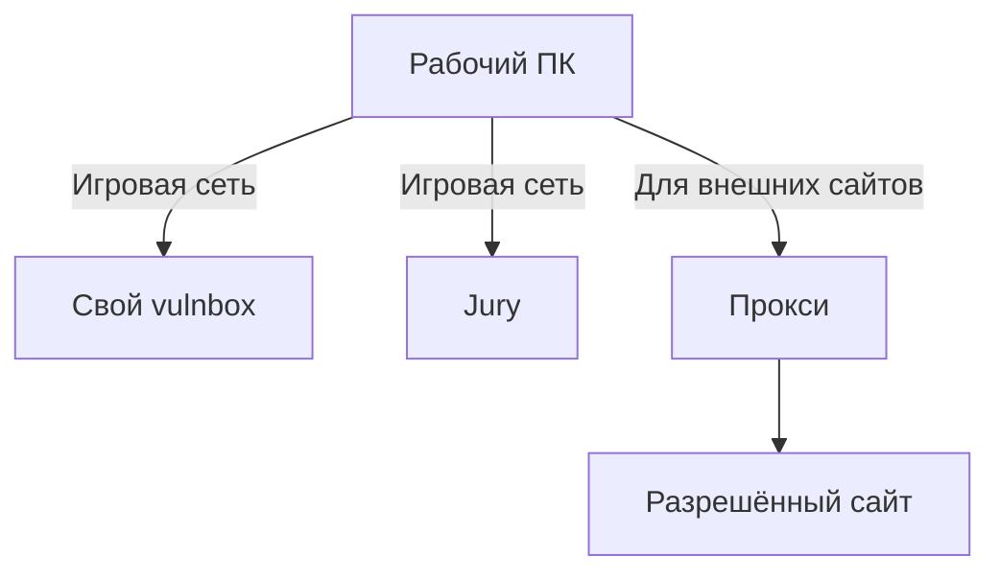

# 05. Сеть и прокси на A/D

[Оглавление](./README.md) · [Рабочий ПК](./04-workstation.md)

Если сайт не открывается, сначала выясни, **на каком шаге пропадает связь**: у ПК нет маршрута, порт недоступен, приложение вернуло HTTP-ошибку, запрос попал в прокси или клиент отклонил сертификат. У каждого случая своя проверка. В примерах работаем с собственным vulnbox и официальными адресами площадки.

## 1. Карта сети InnoCTF

| Что | Адрес из инструкции | Роль |
|---|---|---|
| Сеть команды | `10.2.X.0/24` | Адресный диапазон команды. Значение `X` берётся из выдачи |
| Свой vulnbox | `10.2.X.2` | Сервер ваших игровых приложений |
| Шлюз команды | `10.2.X.1` | Узел связи с другой сетью |
| Jury / ForcAD | `http://10.10.10.10/` | Судейское табло. Для HTTP по умолчанию порт `80` |
| Прокси площадки | `http://10.10.10.10:8080` | Посредник для разрешённых внешних сайтов |
| Страница сертификата прокси | `http://10.10.10.10:8080/cert` | Адрес из презентации. Формат и установку сверяй с инструкцией |

Если `X = 17`, адрес своего сервера — `10.2.17.2`, а шлюза — `10.2.17.1`. Из этой схемы нельзя вычислить адрес своего рабочего ПК, способ подключения или порт конкретного сервиса. Их берут из выдачи или проверяют на своей машине.



Схема показывает направления запросов, а физическая маршрутизация определяется площадкой. Jury и прокси могут иметь один IP и разные порты, как на InnoCTF. Обычная проверка Jury и своего сервиса проводится напрямую, если так предписывает схема площадки. Внешние сайты проверяются через прокси по списку организаторов. [Шпаргалка InnoCTF](../AD_PRESTART.md)

## 2. Что значит адрес, порт и маршрут

| Термин | Что означает на практике |
|---|---|
| **Интерфейс** | Точка подключения к сети. Например, Ethernet, Wi-Fi или туннель. У каждого могут быть свои адреса и маршруты |
| **IPv4** | Адрес вида `10.2.17.2`. Для подключения нужно знать нужный адрес и допустимый путь до него |
| **Подсеть `/24`** | Первые 24 бита задают сеть. В `10.2.17.0/24` это `10.2.17`. Адрес рабочего ПК и шлюз берутся из настроек площадки |
| **Маршрут** | Запись, по которой ОС выбирает интерфейс и, если нужно, следующий шлюз. При подключённом VPN может быть несколько маршрутов |
| **Порт** | Номер службы на данном хосте. Например, `22/tcp` часто используют для SSH. Порт приложения берётся из конфигурации |
| **Loopback** | `127.0.0.1` в IPv4 и `::1` в IPv6 ведут на текущую машину. После SSH это сервер, до SSH — твой ПК |
| **NAT** | Механизм изменения адресов или портов при пересылке. Адрес, который виден приложению, может отличаться от исходного |
| **DNS** | Преобразует имя хоста в IP. Запрос к известному IP помогает проверить связность отдельно от поиска имени |

На слайде InnoCTF сказано, что межкомандные запросы на стороне вашего сервера видны с адреса шлюза `10.2.X.1`. Такой адрес сам по себе не позволяет определить исходную команду и не доказывает, что запрос вредоносный. Общее ограничение шлюза может нарушить доступ из игровой сети. Изменения сети согласуй с ответственным за доступ и проверяй штатную работу после каждого изменения.

## 3. Диагностика, шаг 1. Есть ли маршрут

**Где:** рабочий ПК, Linux или WSL. `10.2.17.2` здесь условный адрес **вашего** vulnbox.

```bash
ip -br address
ip route
ip route get 10.2.17.2
ip route get 10.10.10.10
```

- `ip -br address` показывает интерфейсы и их адреса в кратком виде.
- `ip route` показывает таблицу маршрутов.
- `ip route get` спрашивает ядро, как оно бы отправило пакет к указанному адресу. Этот запрос сам по себе не устанавливает соединение с удалённым хостом. [Руководство ip-route](https://man7.org/linux/man-pages/man8/ip-route.8.html)

Условный пример:

```text
10.2.17.2 dev eth0 src 10.2.17.23
10.10.10.10 via 10.2.17.1 dev eth0 src 10.2.17.23
```

`dev eth0` — выбранный интерфейс, `src` — адрес отправителя, `via` — следующий шлюз. Если интерфейс или источник неожиданны, сравни их с выдачей площадки. Маршрут через домашний шлюз вместо игрового интерфейса может объяснить таймаут. Успешный вывод `ip route get` означает только выбор пути. Он ещё не подтверждает, что сервер ответит.

В Windows маршрут и проверку TCP удобно посмотреть через `Test-NetConnection 10.2.17.2 -Port 22 -InformationLevel Detailed`. Если WSL и Windows показывают разные результаты, зафиксируй, какой клиент и какая среда работают. [Test-NetConnection](https://learn.microsoft.com/powershell/module/nettcpip/test-netconnection) · [Сеть WSL](https://learn.microsoft.com/windows/wsl/networking)

## 4. Диагностика, шаг 2. Что с портом и приложением

После открытия разрешённого доступа проверь известный служебный порт, а для HTTP повтори проверку с нормальным маршрутом приложения. Пример для своего учебного сервиса на `8080`:

**Где:** рабочий ПК, Linux или WSL.

```bash
curl --noproxy '*' -sS -i --connect-timeout 4 --max-time 8   "http://10.2.17.2:8080/health"
```

В PowerShell вызови `curl.exe` с теми же флагами в одной строке. Замени адрес, порт и `/health` на параметры вашего приложения. Если такого пути нет, используй известный штатный путь.

| Параметр | Что делает |
|---|---|
| `--noproxy '*'` | Выполняет этот запрос напрямую, даже если прокси задан в окружении |
| `-sS` | Скрывает полоску загрузки, но оставляет сообщения об ошибках |
| `-i` | Печатает заголовки ответа вместе с телом |
| `--connect-timeout 4` | Ограничивает этап установления соединения |
| `--max-time 8` | Ограничивает длительность операции |

[Справочник параметров curl](https://curl.se/docs/manpage.html)

### Как прочитать результат

| Что получилось | Что это доказывает | Что проверить дальше |
|---|---|---|
| `HTTP 200` | HTTP-запрос дошёл и получил успешный ответ на этот путь | Войти в приложение, создать и прочитать свою учебную запись, если это положенные действия |
| `HTTP 301/302` | Сервер прислал перенаправление | Заголовок `Location`. Возможно, ведёт на HTTPS или страницу входа |
| `HTTP 401/403` | Ответил сервер, приложение или промежуточный узел | Чей это ответ и какие права ожидаются на маршруте |
| `HTTP 404` | HTTP отвечает, этот путь не найден | Используется ли нужный путь и нужный хост |
| `HTTP 500` | Обработчик или промежуточный сервер вернул ошибку | Логи за время запроса, состояние нужной зависимости |
| `Connection refused` | Попытка соединения получила отказ | Порт, процесс, адрес прослушивания, правила сети |
| `Connection timed out` | Запрос не уложился в лимит | Маршрут, этап по времени, фаза игры, доступность из нужной сети |
| Ошибка сертификата | Клиент дошёл до этапа TLS, но проверка не прошла | Имя хоста, действительность сертификата, доверенная цепочка и участие прокси |

Если нужен SSH, то `Permission denied` означает сбой входа после контакта с SSH-сервером. Ошибка сети возникает раньше. Если `ping` не отвечает, это тоже не окончательный диагноз: ICMP и TCP могут обрабатываться по разным правилам.

### Сервис открывается только на самом vulnbox

Проверь, где сервис слушает. **Где:** свой vulnbox, если уже есть доступ.

```bash
sudo ss -lntp
```

`-l` — слушающие сокеты, `-n` — числовые адреса и порты, `-t` — TCP, `-p` — процесс, если виден с твоими правами. Если приложение слушает на `127.0.0.1:8080`, напрямую с ПК этот сокет недоступен. Возможно, по схеме его должен публиковать обратный прокси или Docker. Если в описании Docker стоит `0.0.0.0:8080->80/tcp`, `8080` — порт хоста, `80` — порт в контейнере. Сначала установи штатную схему сервиса, затем решай, что исправлять. [Руководство ss](https://man7.org/linux/man-pages/man8/ss.8.html) · [Публикация портов Docker](https://docs.docker.com/engine/network/port-publishing/)

## 5. Диагностика, шаг 3. Прокси и прямой запрос

**Прокси** принимает запрос от клиента и связывается с нужным ресурсом по своим правилам. На слайде InnoCTF указаны список разрешённых сайтов и ограничение на `GET`. Способ обращения к внешнему HTTPS уточняй по инструкции. В частности, команда `curl -I` отправляет HTTP `HEAD`, поэтому для проверки правила «разрешён только GET» используй обычный запрос, как в примере ниже.

### Проверка Jury напрямую

**Где:** ПК, когда Jury доступен с сети команды.

```bash
curl --noproxy '*' -sS -i --connect-timeout 4 --max-time 8   http://10.10.10.10/
```

Если браузер показывает отказ прокси, а эта команда успешно получает ответ Jury, настрой исключение для игрового адреса в браузере или используй отдельный профиль. Не меняй глобальные сетевые настройки по одному такому наблюдению.

### Проверка разрешённого внешнего сайта

**Где:** ПК, после подтверждения адреса прокси. Замени `https://allowed.example/` адресом из списка организаторов.

```bash
curl --proxy http://10.10.10.10:8080 --noproxy ""   -sS -i --connect-timeout 4 --max-time 10 "https://allowed.example/"
```

`--proxy` выбирает прокси для запроса. `--noproxy ""` позволяет проверить явно указанный прокси, даже если адрес иначе исключён переменной `NO_PROXY`. `https://allowed.example/` — заглушка, запрос сможет дойти только с реальным разрешённым адресом и корректными настройками площадки.

Если ответил сам прокси, его сообщение может относиться к списку разрешённых сайтов, методу запроса или авторизации. При `407 Proxy Authentication Required` уточни у организаторов порядок доступа. Если HTTP-запросы проходят, а внешний HTTPS отклоняется, сначала сверь, поддерживается ли он этим прокси. [Параметры curl](https://curl.se/docs/manpage.html)

### Прокси в браузере

В Firefox найди **Proxy / Настройки прокси** через поиск по настройкам. Точное расположение менялось между версиями. Если площадка дала ручную настройку, подставь адрес и порт из выдачи, а для игрового трафика настрой исключения по инструкции. Удобно завести отдельный игровой профиль, чтобы настройки не смешивались с повседневным браузером. [Настройка прокси Firefox](https://support.mozilla.org/en-US/kb/connection-settings-firefox)

## 6. Сертификат прокси и HTTPS

**TLS** защищает соединение и позволяет клиенту проверить его другую сторону. При обычном HTTPS клиент проверяет сертификат для имени сайта и цепочку доверия. Некоторые прокси площадок завершают TLS у себя и предъявляют сертификаты, подписанные учебным центром сертификации. Если организаторы используют именно такую схему, они дают свой CA и инструкцию по его проверке. Для простого туннеля через прокси отдельный CA может не понадобиться.

1. По инструкции организаторов подтверди адрес выдачи сертификата и способ проверки подлинности.
2. Если указан адрес `/cert`, скачай или открой его из игровой сети по выданному порядку. Он может отдать сам сертификат или страницу с инструкцией.
3. Для полученного PEM-файла можно посмотреть данные и SHA-256-отпечаток. Сравни отпечаток с тем, который предоставила площадка по доверенному каналу.
4. Ограничь область доверия инструментом или игровым профилем, если это поддерживается. Установка в системное хранилище влияет и на другие программы. Следуй выданному способу.
5. Если проверка имени, времени действия или цепочки по-прежнему падает, сохрани точную ошибку и уточни настройку у площадки.

**Где:** ПК с OpenSSL. Подставь имя подтверждённого PEM-файла:

```bash
openssl x509 -in proxy-ca.pem -noout -subject -issuer -dates -fingerprint -sha256
```

`subject` — кем представлен сертификат, `issuer` — кто его подписал, `dates` — период действия. Эти поля можно смотреть без изменения доверенных сертификатов. Если команда сообщает, что не может прочитать файл, проверь формат и содержимое по инструкции. Скачанная веб-страница не станет сертификатом от смены расширения.

Для одного тестового HTTPS-запроса, когда прокси площадки предъявляет сертификат сайта, подписанный выданным CA, в подходящей сборке curl можно указать CA на время команды:

```bash
curl --proxy http://10.10.10.10:8080 --noproxy ""   --cacert ./proxy-ca.pem -sS -i --max-time 10 "https://allowed.example/"
```

`--cacert` здесь задаёт проверку TLS для целевого HTTPS-соединения. Если адрес самого прокси начинается с `https://` и нужно отдельно настроить TLS до прокси, у curl для этого есть `--proxy-cacert`. Это разные уровни соединения. Нужный вариант берётся из инструкции площадки. [Параметры TLS в curl](https://curl.se/docs/manpage.html) · [OpenSSL x509](https://docs.openssl.org/3.5/man1/openssl-x509/)

## 7. Что отправить напарнику

> 10:37. Windows открывает Jury напрямую. Из WSL `ip route get 10.10.10.10` выбирает другой интерфейс и curl уходит в таймаут. До старта проверяю HTTP из Windows. Нужна ли на площадке отдельная настройка для WSL?

Для сбоя есть время, источник, адрес, выбранный путь и результат. Если доступен только один клиент, напиши это. Для запроса жюри добавь номер команды, точный сервис и тик, если проверка связана с табло.

## 8. Самопроверка

1. `ip route get` показал маршрут. Значит ли это, что сервис принимает HTTP?
2. На vulnbox `127.0.0.1:8080` работает, с ПК прямой запрос к порту не проходит. Что проверять?
3. Jury работает из PowerShell, а из WSL таймаут. Где искать отличие?
4. Ты проверял прокси командой `curl -I` и получил отказ. Что проверить в самой команде?
5. Сайт через прокси отвечает, но curl сообщает об ошибке сертификата. Что проверишь первым?

<details>
<summary>Ответы</summary>

1. Нет. Выбран только путь. Нужен отдельный тест подключения и штатного действия приложения.
2. Адрес прослушивания, схему прокси и публикацию Docker, если они используются.
3. Сравнить маршрут, исходный интерфейс и параметры прокси у двух клиентов.
4. `-I` отправляет HEAD. Для проверки условия «разрешён GET» используй обычный запрос к разрешённому ресурсу.
5. Уточнить схему HTTPS на турнире, имя и срок действия сертификата, правильность цепочки и отпечаток выданного CA.

</details>
