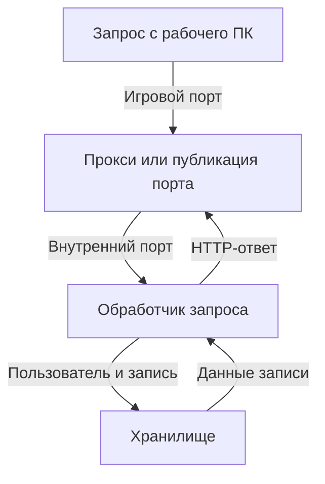

# 09. Как читать незнакомый сервис

[Оглавление](./README.md) · [Инвентарь сервисов](./07-service-inventory.md) · [Бэкапы и восстановление](./08-backup-and-restore.md)

Тебе выдали репозиторий с «Заметками». В нём лежат Compose-файл, несколько Python-модулей и миграции. С чего начать? Возьми **одно известное действие пользователя** — открыть свою старую заметку — и проследи, что происходит от входного порта до ответа. После этого станет ясно, где искать настройки и какой тест повторить после правки.

## 1. Карта, которую нужно получить

| Слой | Вопрос | Ответ в учебном примере |
|---|---|---|
| Вход | Какой адрес и порт использует ПК? | `http://10.2.17.2:8080` |
| Прокси или публикация | Где принимается сетевое соединение? | Compose публикует порт хоста `8080` на `8000` веб-контейнера |
| Запуск | Какая команда поднимает приложение? | Сервер импортирует объект `app` из Python-модуля |
| Обработчик | Какая функция получает запрос? | `read_note` для `GET /notes/:id` |
| Права доступа | Как приложение знает, чья запись? | Учётка берётся из сессии, а чтение ограничено её идентификатором |
| Данные | Кто читает запись и где она хранится? | Слой доступа запрашивает БД из настроек окружения |
| Ответ | Как понять, что сценарий прошёл? | При входе под владельцем открывается нужная заметка с ожидаемым текстом |

Это вымышленный проект. Для реального сервиса используй собственную карточку из [главы 07](./07-service-inventory.md). Если за приложением есть отдельный прокси или балансировщик, добавь этот слой. Если входа по HTTP нет, выбери обычную команду клиента из выданного протокола и проследи обработчик такой операции.



## 2. Найди фактическую точку запуска

**Где:** каталог исходников своего сервиса или его локальной копии.

```bash
pwd
ls -la
rg --files --hidden -g '!.git/**'   -g 'compose*.y*ml' -g 'docker-compose*.y*ml' -g 'Dockerfile*'   -g '*.service' -g 'pyproject.toml' -g 'requirements*.txt'   -g 'package.json' -g 'go.mod' -g 'Cargo.toml'
```

`pwd` показывает, где ты сейчас. `ls -la` показывает файлы, включая скрытые. `rg --files` перечисляет имена. Флаги `-g` ограничивают список шаблонами, а `--hidden` включает скрытые пути. Если `rg` не установлен, открой список в файловом менеджере или используй редактор. Команда не перечисляет файлы, игнорируемые обычными правилами ripgrep, поэтому нужный конфиг из выдачи при необходимости открой по известному пути.

### Если сервис в Compose

Сначала открой тот `compose.yaml`, который используется в нужном проекте. По секции `services` найди внешний контейнер и возможную БД. Сверь исходник с данными, которые узнал из `docker compose ls` и `docker ps`.

| Поле | Что выяснить |
|---|---|
| `ports` | Сопоставление порта хоста и контейнера |
| `image` / `build` | Откуда взялся текущий образ или где инструкции сборки |
| `command` / `entrypoint` | Что запускают вместо настроек образа или вместе с ними |
| `volumes` | Что контейнер читает с хоста или через именованный том |
| `environment` / `env_file` | Какие настройки ждёт приложение и где их задают |
| `depends_on` | От каких сервисов зависит запуск. Отдельно выясни, как подтверждается их готовность |

В Dockerfile посмотри `ENTRYPOINT`, `CMD`, `WORKDIR` и `COPY`. Рабочий каталог и путь модуля помогают найти точку входа. У проекта может быть отдельный скрипт запуска. Тогда открой его и посмотри, какой процесс он запускает в конце.

**Где:** vulnbox, если у команды есть разрешённый доступ к Docker. Входи в тот же каталог и выбирай те же Compose-файлы, что использовались при запуске. Для простого проекта доступны команды чтения:

```bash
sudo docker compose config --services
sudo docker compose ps --all
```

Первая выводит имена сервисов в рассчитанной конфигурации, вторая — текущее состояние контейнеров. Файл описывает предполагаемый запуск, а контейнер мог быть создан раньше с другими настройками. Сопоставь их. Полный вывод `docker compose config` может включать подставленные значения переменных. Для общей заметки достаточно имён, путей и связей. [Документация Compose config](https://docs.docker.com/reference/cli/docker/compose/config/) · [Состояние контейнеров Compose](https://docs.docker.com/reference/cli/docker/compose/ps/)

### Если сервис в systemd

**Где:** свой vulnbox. Подставь имя юнита, найденное в [инвентаре](./07-service-inventory.md).

```bash
systemctl show notes.service -p FragmentPath -p DropInPaths -p WorkingDirectory
systemctl cat notes.service
```

В `WorkingDirectory` виден рабочий каталог, который часто используется для относительных путей. `ExecStart` покажет программу запуска. `EnvironmentFile` может указывать на файл параметров, а drop-in — менять поведение основного юнита. Смотри описание локально. В командный журнал записывай имена переменных и пути без их секретных значений.

## 3. Найди маршрут и прочитай один обработчик

Допустим, вы уже пользуетесь страницей `/notes/42` как обычный владелец своей учебной заметки. В исходниках путь может выглядеть как `/notes/<int:note_id>`, `/notes/{id}` или быть склеенным из префикса и части маршрута. Начни с понятной части имени.

**Где:** каталог своего учебного приложения.

```bash
rg -n 'notes|register_blueprint|include_router' app
```

Подставь реальный каталог вместо `app`. `-n` показывает номера строк. `register_blueprint` и `include_router` — распространённые названия для подключения группы маршрутов в Python-фреймворках. Если совпадений нет, проверь точку входа, имена пакетов, префикс прокси и документацию проекта. Открой сначала небольшой участок вокруг найденной функции. Затем найди, где вызывается слой работы с БД.

Учебный фрагмент на Flask показывает, какие вопросы задавать при чтении. Он рассчитан на приложение, где уже определены `app`, `session`, `db` и `render_template`.

```python
@app.get("/notes/<int:note_id>")
def read_note(note_id):
    user_id = session.get("user_id")
    if user_id is None:
        return "Sign in first", 401

    note = db.execute(
        "SELECT id, title, body FROM notes WHERE id = ? AND owner_id = ?",
        (note_id, user_id),
    ).fetchone()
    if note is None:
        return "Note not found", 404

    return render_template("note.html", note=note)
```

| Где остановиться при чтении | Что понять |
|---|---|
| Декоратор `@app.get` | Метод и шаблон пути, который приводит в функцию |
| `session.get("user_id")` | Откуда приложение берёт личность пользователя |
| `if user_id is None` | Что происходит без входа |
| `db.execute(...)` | Какой объект читают, какие параметры передаются и как учитывается владелец |
| `fetchone()` | Как обрабатывают один результат или его отсутствие |
| `render_template(...)` | Где список данных превращается в HTTP-страницу |

Параметры запроса к БД здесь передаются отдельно от SQL. Фрагмент демонстрирует один корректный сценарий чтения. В своём сервисе дальше ищи фактическую реализацию роли, схему таблиц и ожидаемое поведение из тестов.

## 4. Пойми хранение до любой правки

Маршрут привёл к `db.execute`. Теперь нужно найти создание подключения.

1. Найди модуль, который создаёт `db`. Если это абстракция, открой фабрику приложения или механизм внедрения зависимостей.
2. Выпиши **имена настроек** и их назначение. Например, `DATABASE_PATH` для SQLite либо `DB_HOST` и `DB_NAME` для отдельной БД.
3. Сверь источник параметров. Это может быть конфиг, файл окружения, Compose, systemd или параметры запуска.
4. Определи, к какому экземпляру и каталогу приложение реально обращается. У контейнера сверяй путь внутри него с `Mounts` на хосте.
5. Найди миграции и структуру данных. В учебной таблице `notes` важны `id`, `owner_id`, `title` и `body`.
6. Запиши, что должно пережить перезапуск. Для «Заметок» это как минимум учётка и ранее созданная запись.

Для Compose внутреннее имя соседнего сервиса может выглядеть как `db`. `localhost` внутри веб-контейнера относится к нему самому. Если после правки приложение стало использовать другой адрес или файл, новые записи могут появляться в пустой БД, пока старые лежат в прежней. Сначала сверяй настройку подключения. [Сеть Docker Compose](https://docs.docker.com/compose/how-tos/networking/) · [Как сохранить данные](./08-backup-and-restore.md)

## 5. Проверь карту обычным сценарием

**Где:** с рабочего ПК, на своём учебном или выданном сервисе. Используй тестовую учётку, которая принадлежит тебе.

| Действие | Что подтвердить | Где смотреть при сбое |
|---|---|---|
| Открыть известный адрес | Приходит ответ ожидаемого приложения | Маршрут, порт, хост, публикация или прокси |
| Войти своим пользователем | Сессия появляется, открывается личная область | Обработчик входа, конфиг сессии и БД |
| Прочитать старую тестовую запись | Открывается ожидаемый заголовок и текст | Маршрут, пользователь, путь к БД и данные |
| Создать новую запись и открыть её | Работают запись и чтение | Валидация, слой данных, доступность записи в БД |
| Выйти и войти снова | Данные читаются в новом сеансе | Сессия и постоянное хранилище |

Сопоставь время действия с логом именно этого приложения. Один `200 OK` с главной страницы подтверждает только этот ответ. Для сравнения после изменений запиши, какие действия были выполнены и где они прошли. Точные действия Jury могут отличаться от вашего теста. Проверяй судейский статус отдельно после нового раунда.

## 6. Что записать для напарника

> «Заметки», 10:28. С ПК порт 8080 ведёт на 8000 веб-контейнера. Запуск записан в Compose. Чтение проходит через read_note и текущего пользователя, данные берутся из отдельной БД. До правки со своей тестовой учётки прочитал старую заметку, записал и открыл новую. Бэкап БД ведём отдельно.

Эта запись лучше списка из двадцати файлов: ясно, по какой цепочке прошёл запрос и чем ты это подтвердил. Отметь, что проверено своими глазами, а что пока является предположением. Например, запись `предположительно notes-data, подтвержу через Mounts` помогает напарнику понять следующий шаг.

## 7. Мини-тренировка

1. Возьми свой учебный сервис и выпиши один штатный маршрут.
2. Найди точку запуска, обработчик, место проверки доступа и создание подключения к БД.
3. Прочитай старую учебную запись, затем создай и прочитай новую.
4. Нарисуй карту из шести звеньев. Подпиши реальные имена файлов и один лог, который откроешь при сбое.
5. Передай карту напарнику. Если он может повторить тест без твоего устного комментария, в карте достаточно информации.

Короткие вопросы для самопроверки:

- Почему `ports` и `command` отвечают на разные вопросы?
- Почему найденный Compose-файл и реально запущенный контейнер иногда описывают разные вещи?
- Что проверишь, если вход работает, а старая запись исчезла после перезапуска?

<details>
<summary>Ответы</summary>

- `ports` связывает сетевой вход с контейнером. `command` участвует в выборе команды процесса, который запускается внутри.
- Контейнер может быть создан раньше или с другими файлами, окружением и именем проекта. Сверь фактическое состояние и порядок запуска.
- Сначала проверь источник конфигурации и фактическую базу или том. Старая запись могла сохраниться в прежнем хранилище.

</details>
